# JOEYY tap page: design log

Every iteration of the page a diner sees after tapping a JOEYY stand, newest first. Screenshots are
in [docs/iterations/](docs/iterations/). From v3.4 on, each iteration is also a git commit with a
tag (`git tag -l 'design-*'`), so any version can be checked out and run again.

Design explorations that weren't built live on the Claude Design canvas:
[JOEYY tap page directions](https://claude.ai/artifact/NoWHBxjhcHufoKQ6U2zUno) (private until
shared from its Share menu).

| Version | Date | What changed | Why |
| --- | --- | --- | --- |
| [v4.5](#v45-the-stamp-stage) | 2026-11-22 | A tap opens on a stage: the page steps back, the real card comes in zoomed on its empty slot and the stamp strikes big; the camera pulls back to the whole card with "Stamp 4 of 8" under it; the card glides into its place as the page fades in. A tap skips ahead | Feedback: on the card alone it was easy to miss; a first-time diner who just tapped expects something that grabs them |
| [v4.4](#v44-one-gesture-on-the-card) | 2026-11-22 | The separate stamp page is gone. The stamp lands on the card itself as one gesture: its face appears above the slot, strikes, squashes a little and lifts; the ink stays put; the card gives; the count turns over. Full card: a ripple, a light lift, flecks in the place's ink. Ivory accent; badges in the place's ink; no green outline or accent ring | Feedback: the stamp page felt forced, transitions "0/10", everything boxy; orange read as Claude's colours; green clashed |
| [v4.3](#v43-drawn-paper-and-ink-and-the-stamp-page) | 2026-11-22 | Paper and ink are drawn on canvas: real grain, fibres and mottling in each card's paper, patchy rubber-stamp ink with a rocked double edge. A tap opens a stamp page: a wooden stamp, seen from above, presses the place's paper and lifts; the ink spreads and dries; then it flies into the card | Feedback: still dry and plain, no texture; the hand stamp's angle looked off |
| [v4.2](#v42-search-places) | 2026-11-20 | A search box on Discover finds places by name through the shared backend's Places API; tap a result to see its card | Yemi's task: search the restaurants in our database and open one to see its card |
| [v4.2](#v42-the-stamp-moment) | 2026-11-22 | A tap opens on a full-screen stamp moment: the cover dims, a big stamp in the visit's ink falls and slams down (shockwave rings, ink spatter, shake, double buzz, "Stamp 4 of 8"), then flies into its slot as the card page shows | Feedback: the stamp still wasn't the main focus; it has to land before the rest of the page |
| [v4.1](#v41-stamps-with-punch-paper-with-texture) | 2026-11-15 | Stamps land harder (shadow, squash, wet ink drying, ink flecks, the count pops) and look inked (patchy rubber-stamp ink, heavier rims); the card is real paper (fibres, a security print and rosette in the place's ink, darker edges); empty slots printed as targets, the reward slot heavier | Demo feedback: more pop on the stamps, more texture on the card |
| [v4.0](#v40-the-business-site) | 2026-11-15 | The business site at `/business`: email sign-in, a four-step setup with the real card filling in as you type, stand linking, Today, Card and Stands. A card made there is live on the diner side | Owners had no way to sign up and make their own card |
| [v3.16](#v316-landing-page-profile-and-the-cover) | 2026-11-15 | Landing page with a Try a tap sample card; profile with your name, sign out and delete account; the page is now a printed passport cover (security lines, rosette, grain); quieter foil wordmark; no ring over the newest stamp | Feedback: no page for newcomers, a thin profile, a bare background, a loud wordmark, an awkward ring on new stamps |
| [v3.15](#v315-five-skill-passes-combined) | 2026-11-15 | Tab bar, Discover, panels with icons, milestones, skeletons and empty states; Apple-style springs, drag-to-close sheets, swipe between cards, stamp landing; page slides, drawn-on logo and reward; depth, bigger tap targets; 64 interface-guideline fixes | Feedback: "bare and empty"; tried five community design skills side by side and merged the best of each |
| [v3.14](#v314-profile-page) | 2026-11-15 | A profile page at `/me`: the passport's data page (holder, places, visits, rewards), an entry stamp for every place, and the account controls; the header chip now opens it | Diners had no single place for their account, and sign-out hid in a sheet |
| [v3.13](#v313-sign-in-with-apple-google-or-a-number) | 2026-11-12 | Sign in with Apple, Google or a mobile number with a text code, from one sheet with each brand's own buttons; Face ID / passkeys removed | Team meeting, Nov 11: these three, and no email and password |
| [Rule: repeat taps](#rule-no-limit-on-repeat-taps) | 2026-11-12 | No built-in limit on repeat taps; a business may set its own minimum gap (Sunday Ramen: 30 minutes in the demo) | Team meeting, Nov 11: it's the café's call |
| [v3.12](#v312-warmer-each-place-its-own) | 2026-11-12 | Reward drawn as a cup, bowl, teapot, loaf or cone filling up; restaurant colour across the page; serif headings; rules as rubber stamps; sign-in as one slim row under the card | Feedback: "dry and empty like work", "the sign-in box looks awful" |
| [v3.11](#v311-less-text-more-to-tap) | 2026-11-12 | Save options as three tiles; rules as three figures; visits as a row of date stamps | Feedback: too much text, plain buttons |
| [v3.10](#v310-live-wallet-updates) | 2026-11-12 | Wallet passes update themselves after every stamp and redemption; opened cards offer Add to Wallet and list your other cards | Passes went stale, and opened cards were a dead end |
| [v3.9](#v39-one-demo-backend) | 2026-11-11 | The demo runs on a backend inside the dev server, answering the real `/v1/web` routes; all phones share one state | Links, Wallet passes and sign-in kept falling out of step between browsers |
| [v3.8](#v38-rewards-from-the-wallet-pass) | 2026-11-11 | The Wallet pass leads with a ready reward and has "Use my reward" on the back; the card page offers "Update Wallet card" when the pass is behind | Diners should be able to use rewards straight from Wallet |
| [v3.7](#v37-reorder-your-cards) | 2026-11-11 | Reorder Your cards: press and hold a card and drag it, or Edit order with arrows; order is saved to the account | Diners should arrange their own cards |
| [v3.6](#v36-real-apple-wallet-pass) | 2026-11-11 | Real signed Apple Wallet pass in the passport look, with a working "Open my JOEYY card" link | The button only showed a placeholder |
| [v3.5](#v35-sign-in-on-a-new-phone) | 2026-11-11 | Sign-in on a new phone: "Already use JOEYY?" banner, passkey (Face ID) and text-code sign-in, Welcome back merge, Wallet pass restore link, account chip with sign-out | Returning diners on a fresh phone saw an empty card |
| [Canvas: sign-in](#design-canvas-new-phone-and-ways-back-in) | 2026-11-11 | Mockups: new phone with an existing account, Face ID passkey, text-code fallback, Wallet pass "Open my card" link | Decide how returning diners get their card back |
| [v3.4](#v34-depth-and-motion) | 2026-11-11 | Depth and motion: cards lean back in the stack, tilt and sheen, stamps re-ink, glow, word rise, scroll reveal | Make the page feel physical and alive |
| [v3.3](#v33-card-details) | 2026-11-11 | Details under an opened card and on the card page | Bring back v2's detail (place, progress, rules) in the new style |
| [v3.2](#v32-one-card-at-a-time-eight-places) | 2026-11-11 | Opened card shows alone; eight sample places; deal-in, spring and cascade motion | The pile under the open card was confusing |
| [v3.1](#v31-apple-wallet-slide) | 2026-11-11 | Apple Wallet slide: list → card slides up, others pile below | Feedback: "more like Apple Wallet" |
| [v3](#v3-passport-in-a-wallet-stack) | 2026-11-11 | Passport stamps in a Wallet stack (canvas direction 6), dark navy theme | Picked on the design canvas |
| [Canvas](#design-canvas-exploration) | 2026-11-11 | Six directions plus a Your cards screen, as mockups | Compare looks before building |
| [v2](#v2-richer-card-page) | 2026-11-11 | Business header, verified seal, flip and tilt card, Wallet preview, visits, more spots | Feedback: the page felt empty and unofficial |
| [v1](#v1-paper-card) | 2026-11-11 | First build: punch card matching the iOS app, every tap and error state, redeem and staff screens | First version |

---

## v4.5: the stamp stage

**Why:** "Not flashy enough… keep the idea of a zone page, something to catch the eye of anyone opening
this page for the first time… if I click on something and this page opens, I would hardly even catch
the animation." v4.3's separate stamp page caught the eye but felt boxy and forced; v4.4 on the card
alone was smooth but easy to miss.

**What changed** (`src/ui/stamp-stage.ts`, used by the tap page for `stamped` and `completed`): a
camera move on the real card, so nothing is ever handed from one object to another.
1. The page steps back (fades and drops 14px), the cover dims to a glow in the place's paper colour,
   and the card comes in zoomed (about 2x) on the empty slot.
2. The stamp strikes there (v4.4's gesture), so it's big; the glow flares on contact.
3. The camera pulls back to the whole card, centred; "Stamp 4 of 8" and "4 more to …" rise in under it.
   A full card plays its ripple, lift and flecks here, then its reward ticket prints after it settles.
4. After about a second, or a tap anywhere, the card glides down into its place and the header,
   headline and the rest of the page fade in around it, in that order.
About three seconds in all. Reduced motion, or a business with motion off, skips the stage.

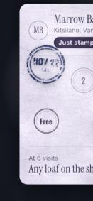
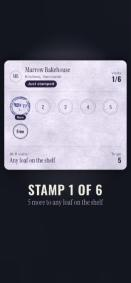

## v4.4: one gesture, on the card

**Why:** "the stamp page feels forced, transitions are like a 0/10, everything feels boxy." The orange
read as Claude's own colours, and the green outline didn't belong.

**How it was decided:** a research pass over Apple Pay's "Done" (WWDC19 *Audio, Haptic and Visual
Design*), Apple Wallet, the HIG on motion and haptics, Emil Kowalski and Rauno Freiberg on motion,
Josh Comeau on particles, Duolingo's milestone celebrations, and how a real rubber stamp moves
(anticipation, strike, small squash, lift; the ink appears at contact). What it said we'd got wrong:
an overlay that took the card away, ink that moved after it landed, and every effect at once.

**What changed:**
- **No stamp page, no overlay.** The page stays usable throughout; nothing else dims or moves.
- **The stamp** (`stampIn`, `src/ui/passport.ts`), 520ms: its inked face appears 24px above the slot,
  slightly large and turned, and rises 4px; strikes down in 90ms; on contact (230ms) squashes 4%, the
  ink appears under it from the centre out, the card gives 1.5px, one buzz, and the "New" tag shows; the
  face lifts 10px and fades. The ink never moves. At 380ms the count turns over.
- **Cut:** the ink splash ring, the fleck spatter and the count pop on a regular stamp.
- **A full card:** two taps of haptics; the earlier stamps ripple outward from the last one; the card
  lifts 3% on a light spring (the only time the whole card moves); a dozen flecks fly up in a 120° cone
  in the place's own ink. The orange ring around the card is gone.
- **Colour:** the accent is ivory (tokens, logo, Wallet icon). "Just stamped" and "New" use the place's
  ink. No outline on a just-stamped card, and no accent ring around the open card.
- Reduced motion: the ink fades in over 150ms and the count changes; nothing moves.

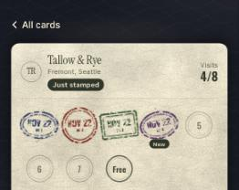

## v4.3: drawn paper and ink, and the stamp page

**Why:** "the animation feels dry and boring… the card design still feels lacking on the texture…
the animation had no texture as well." Then, from a stamp lab with two motions: a stamp page first,
moving on by itself, with the hand press; and "the hand press stamp seems off, maybe the angle".

**What changed:**
- **`src/ui/ink.ts` draws paper and ink on canvas.** CSS circles and SVG masks read as a picture of a
  stamp. Now each business's paper is drawn once: mottled colour, tooth, fibres, a security print and a
  rosette in its own ink. Each stamp is a drawn impression: heavy edges where ink pools, gaps where the
  rubber didn't touch, a faint second edge from the stamp rocking, stray specks. Cached, so each is
  drawn once.
- **The card uses them.** The paper texture is set after the first paint (`--paper-texture`), so the
  page never waits on it. Stamps on the card and on the profile are the drawn impressions, laid into the
  paper with multiply. The old SVG grain, waves, rosette and ink-mask CSS are gone.
- **The stamp page** (`src/ui/stamp-moment.ts`) replaces the v4.2 moment. One camera, looking down:
  a sheet of the place's paper; a wooden rubber stamp comes down toward it (bigger while near the eye,
  its shadow tightening); it presses (the paper darkens under it, the phone buzzes), and lifts away; the
  ink spreads from the centre, wet and glossy, then dries. "Stamp 4 of 8" pops in. After 2.5 seconds,
  or a tap once the stamp has lifted, the impression flies into its slot on the card.
- The lab page used to choose the motion was removed once the choice was made.

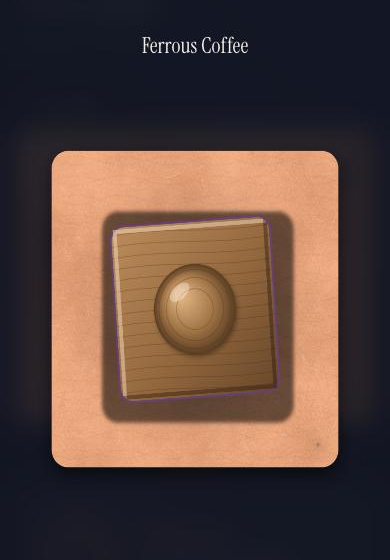
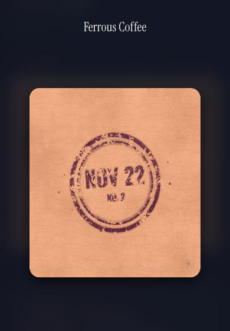
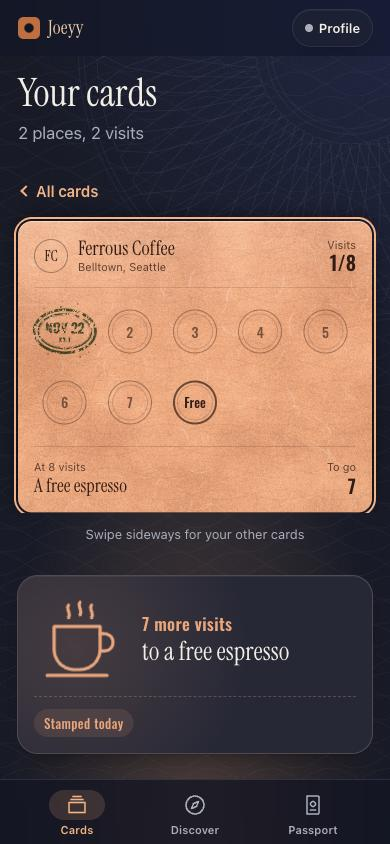

## v4.2: search places

**Why:** the team's task list: build a working search over the restaurants in our database, and let
diners tap one to see its card.

**What changed:**
- **A search box on Discover** (`src/screens/discover.ts`), above the filter chips. It asks the
  shared backend's Places API (`GET /v1/places?query=`, `services/api/src/routes/places.ts`) after a
  short pause in typing, so it finds every live place in the database, not just the ones listed.
  While searching, the chips hide and the results replace the list; clearing the box brings the
  list straight back. "1 place found" is read out to screen readers; no match shows "No places
  found" with a way back to all places; no signal says so in place.
- **Tap a result to see its card:** results are the same place tiles as Discover, so a new place
  opens its details sheet (card, reward, hours, address) and one you already have opens your card.
- **The search is in the address** (`/discover?q=cafe`), so a reload or a shared link keeps it.
- **One shape for screens:** the backend answers `{ places }` with the business's own fields;
  `searchPlaces()` in `src/api/http.ts` turns each into the `PlaceSummary` the tiles already use.
  The demo backend answers `?query=` with the backend's exact rules and shape.

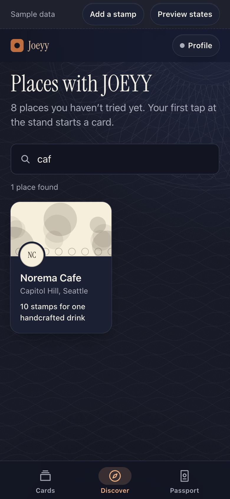 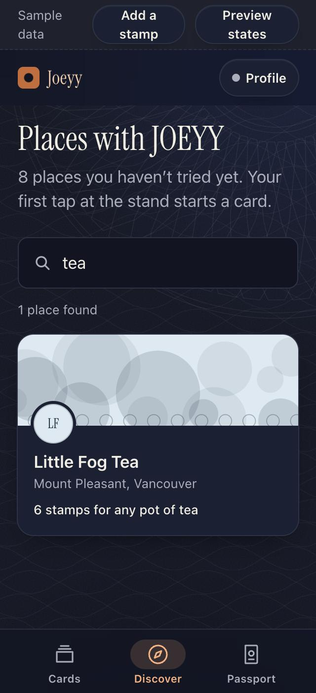

## v4.2: the stamp moment

**Why:** "the stamping is still not flashy enough… it needs to be the main focus before the rest of the page loads."

**What changed** (`src/ui/stamp-moment.ts`, called from the tap page for `stamped` and `completed`):
- Before the card page shows, the cover dims and blurs, lit faintly in the place's paper colour.
- A big stamp, the same shape, ink and angle the card will show for this visit, falls from above the
  screen, blurred and turning, while its shadow gathers on a disc of the place's paper.
- On impact: two shockwave rings and a spatter in the stamp's ink, a short shake, a flash of the
  place's colour, a double buzz, and the count pops in ("Stamp 4 of 8"; a full card says "Card
  complete" with a bigger, four-ink burst).
- After a beat it shrinks and flies into its slot on the card while the dimming lifts; the card
  counts it and gives a little under it (`stampIn(..., { arrived: true })`).
- Reduced motion, or a business that turned motion off, skips the moment and gets the plain stamp.

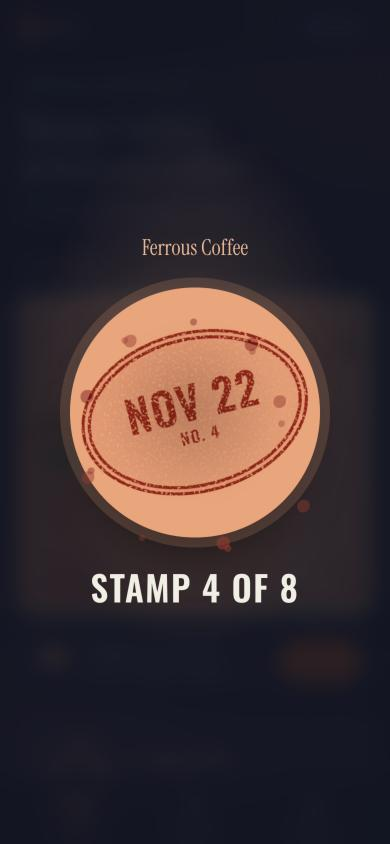

## v4.1: stamps with punch, paper with texture

**Why:** from the demo: "more pop on the stamp side" and "make the card more textured".

**What changed:**
- **The stamp landing** (`stampIn` in `src/ui/passport.ts`): the stamp's shadow gathers on the page
  as it comes down; it lands harder (bigger drop, deeper squash, a small overshoot); the ink lands
  wet (darker, richer) and dries over half a second; a spatter of ink flecks and a thicker ring
  spread from it; the page gives a little more; the visit count pops. The buzz is now a double tap.
  The card-full burst shares the same fleck code (`inkBurst`). Reduced motion still gets none of it.
- **Stamps look inked:** heavier double rims, a wash of ink inside, and a rubber-stamp mask that
  leaves small gaps, each stamp catching a different patch of it.
- **The card is paper:** fine fibres, a security print of interlaced waves and a rosette watermark
  in the place's own ink, light from the top and slightly darker edges. Increase Contrast turns
  the texture off.
- **Empty slots** are printed targets (a ring with a fine inner ring and the number in Oswald); the
  last slot, the reward, has a heavier ring.

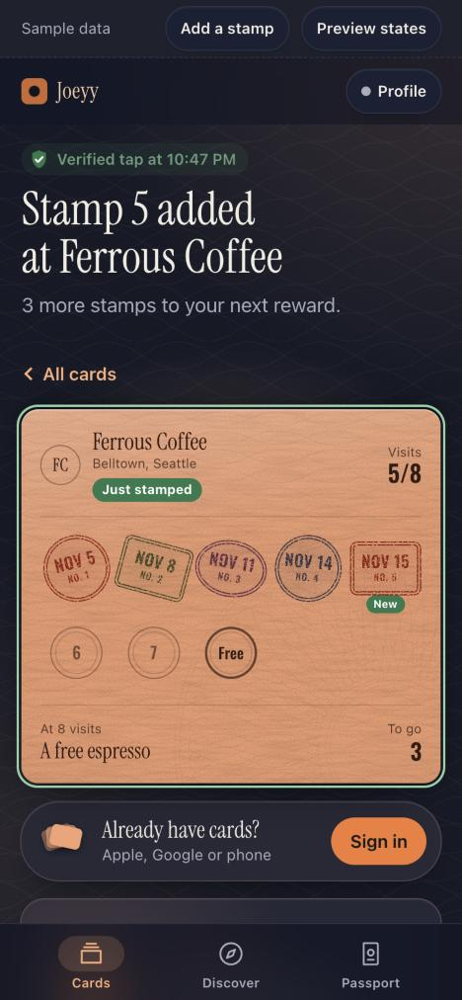
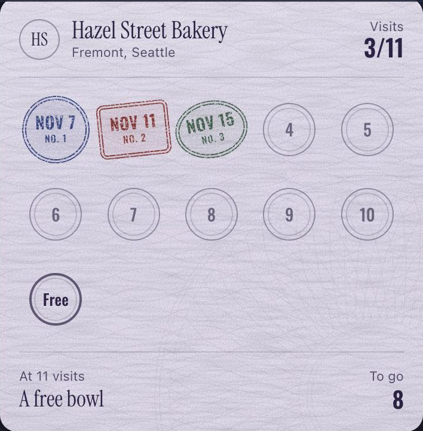

## v4.0: the business site

**Why:** restaurants had no way to sign up or make their own card; every sample place was typed
into the demo by hand. Three directions were drawn first
([docs/business/directions.html](docs/business/directions.html)): A, a laptop "card desk"; B, one
question per screen on a phone; C, a "counter ledger" of the day's taps. The site uses B for setup,
since the kit's QR code opens on the owner's phone with the stand in hand, then C for Today and A for
editing the card.

**What changed:**
- **Same look as the diner side:** the passport navy, the serif headlines, Oswald figures. The card
  preview is the diner's own `passportPage`, so owners see exactly what diners get.
- **`/business`:** "A stamp card that lives on your counter", a sample card, the three steps, and why
  stamps can't be faked. **Make your card** leads to sign-in with a 6-digit email code.
- **Setup (`/business/setup`):** four steps shown as four stamp slots that get stamped as they're
  done. Place, then Reward (with ideas and a 3–20 stepper), then Look (eight papers that all pass 4.5:1,
  four letterings, three cover patterns), then **Publish card**. The card redraws on every keystroke.
  The last step links a stand: a 2-minute window with a pulsing ring; the owner's phone touches the
  stand and the page says "You're live."
- **Today:** stamps, rewards used and new diners in big figures; the day's taps as a till roll
  ("Stamp 3 of 6", "Reward used"); refreshes every 5 seconds; a nudge to link a stand if none works.
- **Card:** the whole card as one form beside a sticky preview; Publish changes makes a new version.
- **Stands:** each stand with when it was last tapped; Turn off (for a lost one) asks first.
- **Backend:** `/v1/partner/*` (docs/business-api.md). A published business with a working stand
  joins Discover, and taps on its stand stamp its card like any sample place.
- **Shared:** the 4.5:1 check moved to `src/ui/contrast.ts`, used by the page and the server.

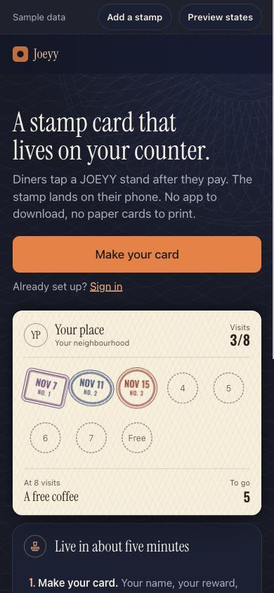
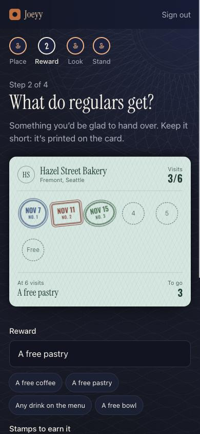
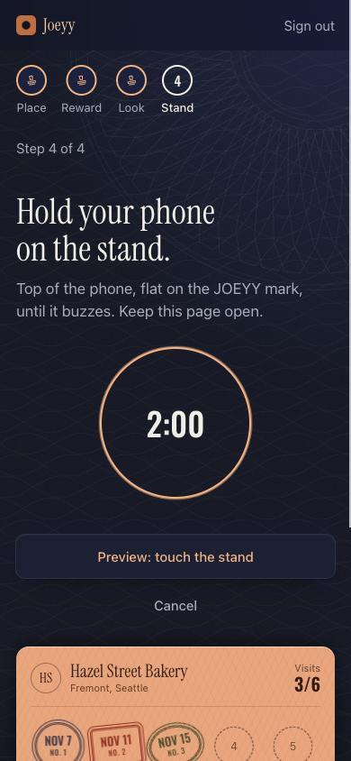
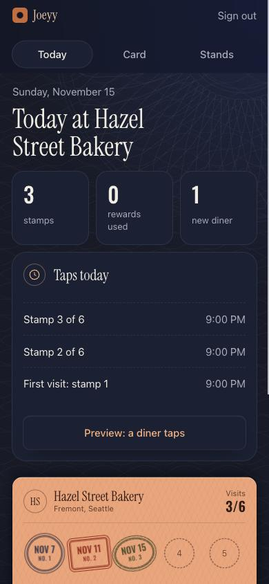

## v3.16: landing page, profile, and the cover

**Why:** newcomers (no cards, not at a counter) had no introduction; the profile couldn't hold a
name or delete the account; the navy ground looked bare next to the paper cards, the "Joeyy"
wordmark shouted, and the ring drawn over a just-landed stamp clashed with the stamp. We asked
the installed skills first (frontend-design, apple-design, glassmorphism, Emil Kowalski's
animate/choreograph/emil-design-eng, make-interfaces-feel-better, mobile-native, Vercel's
guidelines) and built what they agreed on.

**What changed:**
- **Landing (`/`, `src/screens/home.ts`):** "Tap a stand. Get a stamp." over a sample card. Its one
  moving moment waits for the visitor: **Try a tap** stamps the sample with the real stamp press,
  tagged "Sample", and can be repeated. Then **Find a place near you**, sign-in for cards on another
  phone, How JOEYY works, and a note for someone standing at a stand.
- **Profile (`/me`):** the passport's holder line takes your name ("What should we call you?",
  edited in place on the paper, "Only you see this"); "Hi, Sam" in the greeting; sign out; and
  **Delete my account**, a sheet that lists what goes, with Keep my account focused first.
  New routes: `PUT /v1/web/me/profile` and `DELETE /v1/web/me` (docs/identity-and-api.md). Names
  never reach restaurants, the partner app or staff screens.
- **The cover:** the page is now printed like a passport cover: fine interlaced security lines,
  a rosette in the top corner, a faint grain and darker edges. It's still (nothing moves behind the
  cards), under 6% contrast so text stays easy to read, and plain with Increase Contrast.
- **Wordmark:** smaller, in a muted gold foil with a hairline shadow; the page's headline leads.
- **New stamp:** no green ring over it; the "New" tag alone marks it.
- **Fix:** non-restaurant pages had been forcing the passport paper to white (`clearMerchantTheme`
  wrote a fallback over the token); the cream paper is back on the profile and the sample card.

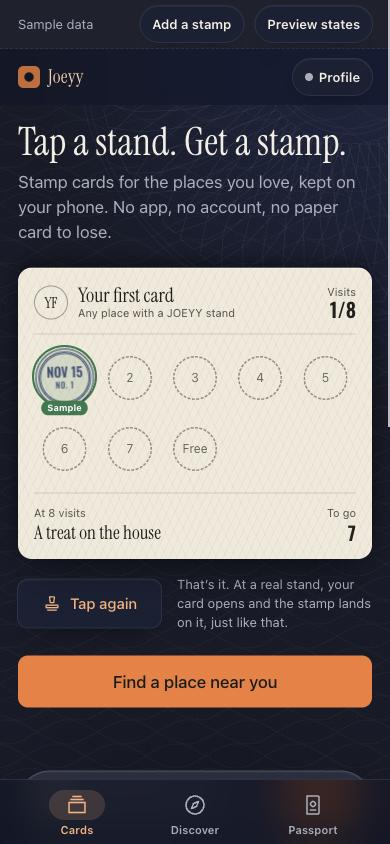
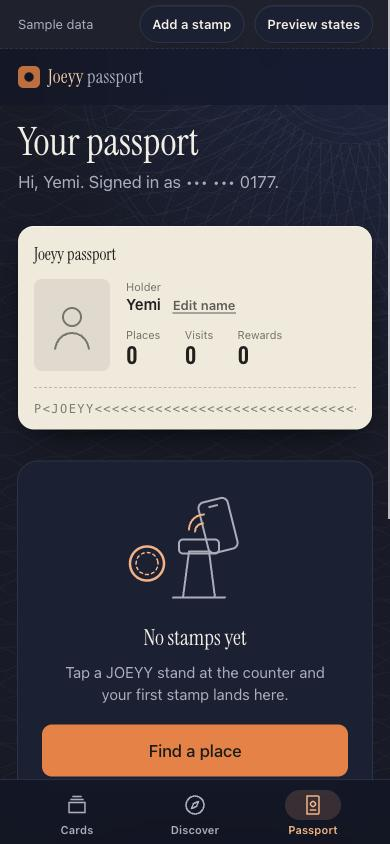
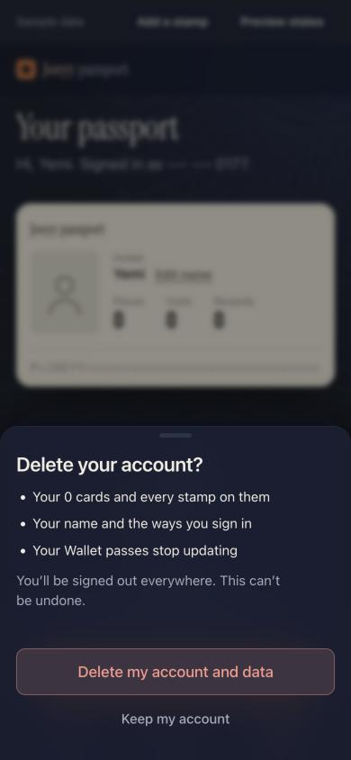

## v3.15: five skill passes, combined

**Why:** the site felt bare. We installed community Claude skills (Jakub Krehel's
make-interfaces-feel-better, Emil Kowalski's apple-design/animate/choreograph/gestures, Vercel's
web-design-guidelines, iart.ai's web-animation set) plus frontend-design, ran each on its own
branch (`skills/*`), compared them, and merged them into one. Where two branches built the same
thing, one version was kept.

**From each branch:**
- **Structure** (frontend-design): tab bar (Cards, Discover, Passport); a Discover page with
  filters; each section under a card is a panel with a line icon; milestones ("3 stamps to go",
  "2 weeks in a row"), a "nearly there" nudge on Your cards and Recent stamps on the passport;
  card-stack skeletons; drawings for empty pages; haptics on tabs and Use now.
- **Apple** (Emil Kowalski): Apple-style springs (`src/ui/spring.ts`); sheets that drag down to
  close; swipe sideways between open cards; one choreographed entrance per page; the frosted
  header; one shared press feedback; the stamp drops, squashes and splashes ink; a full card
  pulses and rings before its reward prints.
- **Motion** (iart.ai): pages slide between routes (View Transitions) while the header and tab
  bar hold still; frosted-glass sheets and toasts; the logo lands and punches its hole, the tick
  draws on, the reward drawing draws its outline then fills and sloshes; visit chips press on.
- **Polish** (make-interfaces-feel-better, mobile-native): depth tokens (edge light and shadow)
  instead of flat rings; 44px tap targets; tabular figures; touch fixes (no tap flash, no
  accidental text selection, overscroll contained).
- **Guidelines** (Vercel): 72 findings, 64 fixed (`docs/skill-guidelines-audit.md`): busy buttons
  with words, toasts in a live region, a spoken redeem countdown, focusable scrollers, long names,
  hover only for real pointers.

**One version kept where they overlapped:** header and press feedback (Apple), celebration when a
card fills (Apple), loading (Guidelines' `loading()`, showing Structure's card-stack skeleton where
it fits), empty states (Structure), page motion (Motion's slide between pages; Apple's entrance
only on a first load).

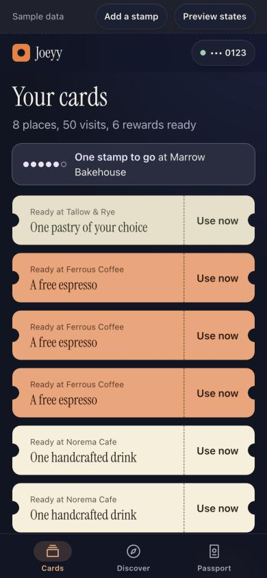
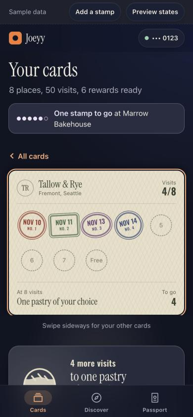
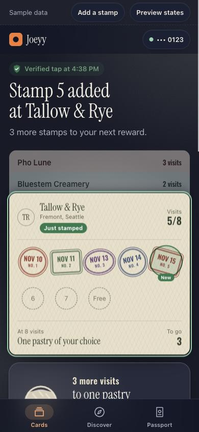

## v3.14: profile page

**Why:** there was no page for the diner themself. Who they're signed in as only showed in a small
header chip, and sign-out was in a sheet behind it.

**What changed:**
- **`/me`, "Your passport":** a paper data page like a real passport's. A holder outline instead of
  a photo (JOEYY never asks for a name or face), then who holds it (Apple or Google email, masked
  number, Wallet pass, or "This phone"), and the places, visits and rewards ready. A
  machine-readable line along the foot spells out each place's initials.
- **Places you've been:** one round entry stamp per place, in that place's ink, at its own angle,
  dated with the last visit. Each opens that card in Your cards.
- **Account:** the same slim row as everywhere (Saved to…, or Keep your cards safe with Save), and
  Sign out of this browser, which still confirms first.
- **Header chip:** on Your cards and card pages it's now a link to `/me`. A grey dot and "Profile"
  when the cards are on this phone only, green with the account name when they're saved.

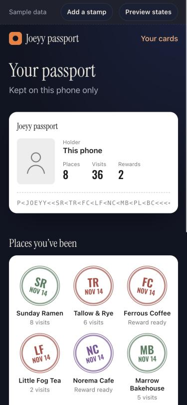

## v3.13: sign in with Apple, Google or a number

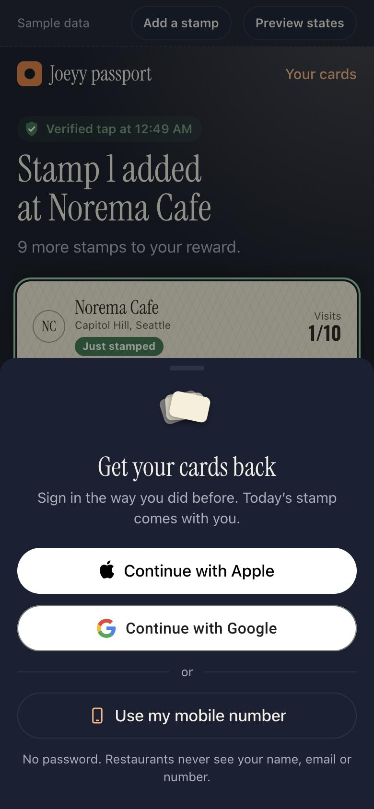
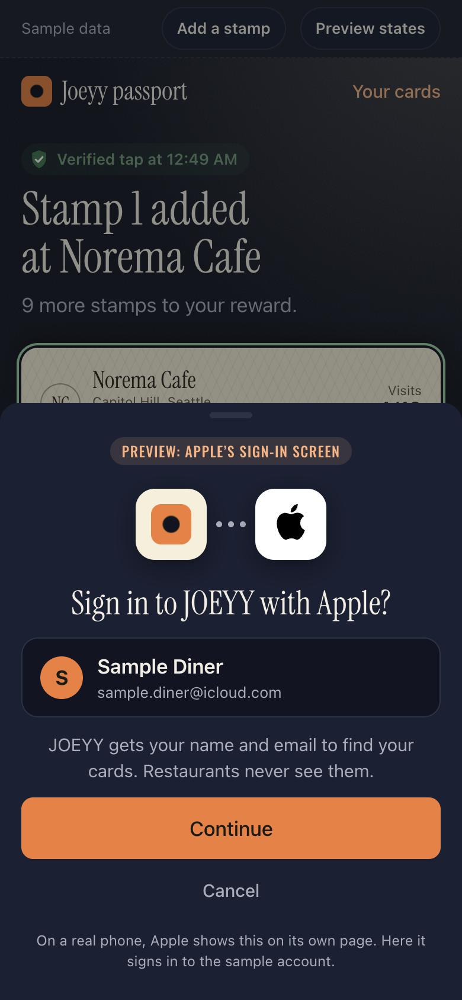
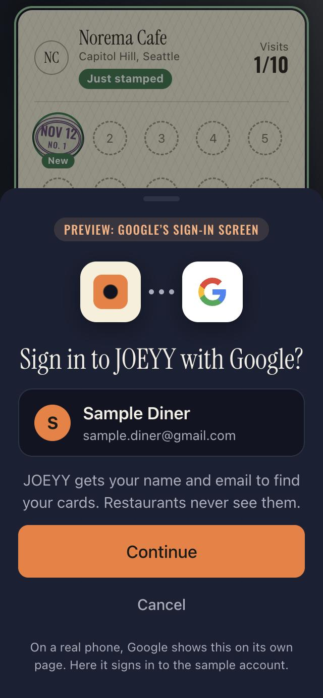
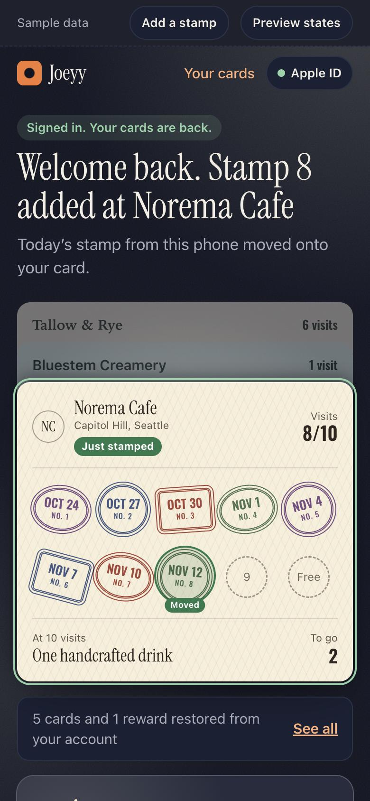

Decided at the Nov 11 team meeting: Apple, Google and phone number replace Face ID / passkeys.
Email and password stays out, so throwaway addresses can't fill the servers with fake accounts.

- **One sheet, three ways in.** The slim "Already have cards?" row from v3.12 stays (now with
  "Apple, Google or phone" under it, hidden on 320px phones). Its Sign in pill opens "Get your cards
  back": a fan of cards in the place's paper colour, an Instrument Serif title, then **Continue with
  Apple**, **Continue with Google**, "or", and **Use my mobile number** (the text-code sheet as before).
- **Brand buttons by the brands' rules.** Apple's white button for dark backgrounds, with the logo
  path from Apple's own Sign in with Apple JS button. Google's light-theme button: white, `#747775`
  outline, Roboto Medium, and the four-colour G from Google's branding guidelines. Both pill-shaped,
  which each allows. They're the only things on the page not in the theme colours, on purpose.
- **Save cards.** The middle "Keep this card" tile is now "Save cards" (it was "Save number") and
  opens the same sheet as "Keep your stamps". Signed in, it shows "••• 0123", "Apple ID" or "Google".
  The header chip and the Your cards row say the same ("Saved to your Apple ID").
- **Preview only:** the demo can't run OAuth, so Continue with Apple / Google opens a stand-in
  consent sheet in the theme, tagged "Preview: Apple's sign-in screen": JOEYY's mark and Apple's (or
  Google's), "Sign in to JOEYY with Apple?", the sample account (`sample.diner@icloud.com` /
  `@gmail.com`), Continue and Cancel. Continue signs in to the sample account with the same merge as
  a text code, so "Welcome back. Stamp 8 added" works the same way.
- **Production** goes to `/v1/web/auth/{provider}/start` and comes back to a new `/signed-in` page;
  the routes and what Apple and Google need are in docs/identity-and-api.md.
- **Preview states → Accounts and sign-in:** "New phone, sign in with Apple", "New phone, sign in
  with Google", "New phone, text code".
- **Removed:** the passkey prompt, "Use Face ID next time?", "Add Face ID", the WebAuthn calls and
  `/api/demo/passkeys/*`, and their CSS.
- **Fixed:** a new-phone Preview state run right after signing in to the sample account no longer
  fails (the demo tried to tidy up an account it had just replaced).

## Rule: no limit on repeat taps

Decided at the Nov 11 team meeting: JOEYY doesn't limit how often a card can be tapped. The demo
backend used to answer a second stamp at the same place within 60 seconds with "Already stamped";
now every new tap stamps. A business can set `minMinutesBetweenStamps` on its program, and then
the "Already stamped" screen comes back for taps sooner than that. Only Sunday Ramen sets one in
the sample data (30 minutes); Preview states > "Tapped again too soon" shows it. The "Allow repeat
taps" setting is gone, and Add a stamp no longer skips anything. Replay protection is unchanged: an
old tap link opened again still gets no stamp. The real backend needs the per-business setting
(docs/identity-and-api.md).

## v3.12: warmer, each place its own

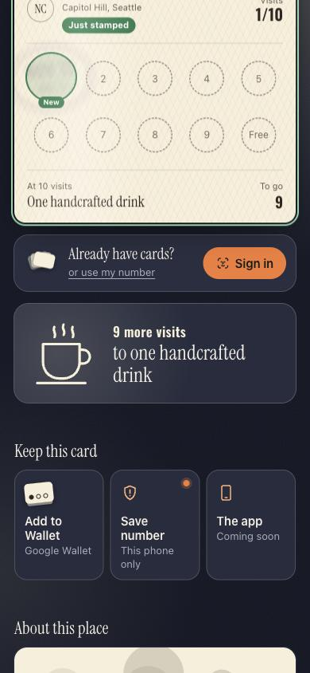
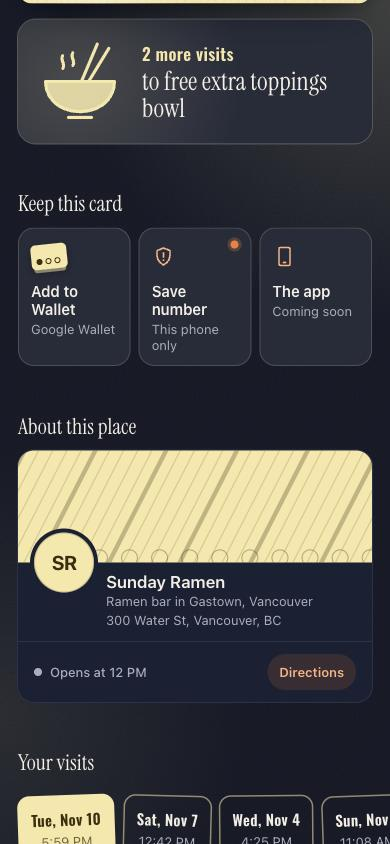
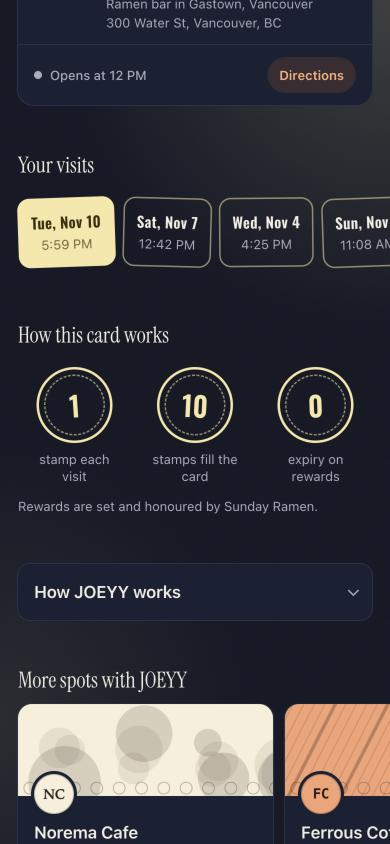
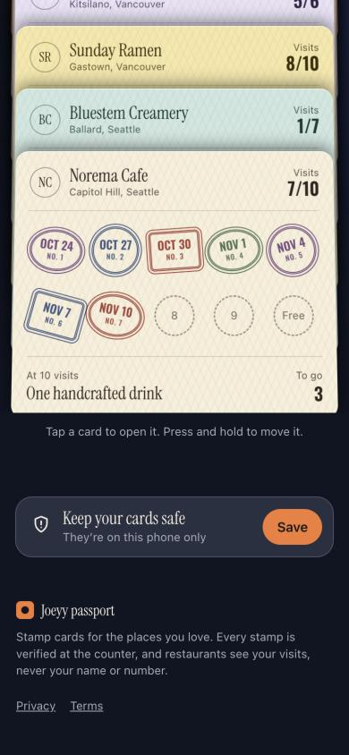

- **The reward fills up.** The next-reward box draws the reward itself in the card's paper
  colour: a cup for cafés and espresso bars, a teapot for tea, a bowl for pho and ramen, a loaf for
  bakeries, a cone for ice cream. It fills to your progress, rising into place when it scrolls in,
  beside "8 more visits to one handcrafted drink" (`src/ui/vessel.ts`).
- **Each place colours its page:** its paper colour glows from the top and low on the left, over a
  faint paper grain. Tiles and boxes pick up a little of it too.
- **Headings** are in Instrument Serif, the passport's face, instead of bold system type.
- **How this card works** shows three rubber stamps (1, 10, 0) in the card's colour, slightly askew.
- **Sign-in:** the orange-outlined box above the headline is now one slim row under the card: a
  fan of card shapes, "Already have cards?", "or use my number", and a Sign in pill. The stamp is
  the first thing you see again.
- **Keep your cards safe:** the "saved in this browser only" paragraph and the "Never lose it
  again" box are the same slim row, with a shield and a Save pill. Signed in, it reads
  "Saved to ••• 0123".

## v3.11: less text, more to tap

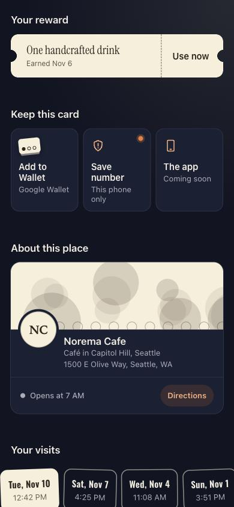
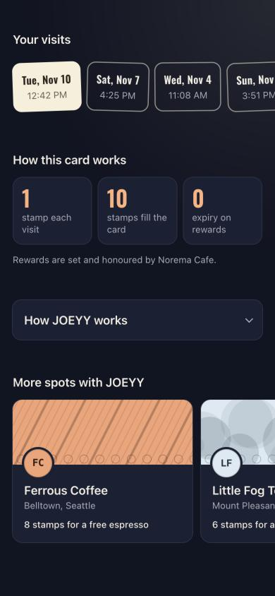

About 60 fewer words and half a screen shorter, on the tap page and on opened cards alike:

- **Keep this card** is three tiles instead of a heading, two paragraphs and three stacked buttons:
  - **Wallet:** a tiny pass in the card's own paper and ink. It reads Add to Wallet, Update, or In
    Wallet with "Updates itself".
  - **Your number:** "Save number" with an orange dot while cards live on this phone only, or
    "••• 0123, Cards saved" once signed in.
  - **The app:** "Coming soon".

  The explaining moved into the sheet each tile opens.
- **How this card works** is three figures: 1 stamp each visit, 10 stamps fill the card, 0 expiry
  on rewards.
- **Your visits** is a sideways row of tilted date stamps, the newest inked in the card's colours.
- Removed the code and styles these replaced (saveActions, the visit list, the rules list, the
  black Wallet buttons).

Before launch, Apple's and Google's brand rules ask for their official Add to Wallet badges, so the
Wallet tile will need to carry the official badge.

## v3.10: live Wallet updates

- **Passes update themselves.** Wallet registers each pass with the demo backend. After a stamp,
  a redemption or a sign-in, the server pushes through Apple, Wallet downloads the new pass, and
  "A free espresso is ready" arrives as a notification when a card fills. The card page then says
  the Wallet card "updates by itself after every visit".
- **Opened cards match the tap page:** a card opened in Your cards shows the same sections, in the
  same order, as the page after a tap (next reward, rewards, Keep it on your lock screen with Add
  to Wallet, the place, visits, rules, how it works). Both come from one function, `cardSections`,
  so they can't drift apart again. At the bottom, "Your other cards" opens any other card in one tap.
- **Phone setting:** Wallet only talks to HTTPS. For the demo's `http://` address, turn on
  Settings → Developer → Allow HTTP Services on the iPhone, then add the pass again.
- **Fix (after v3.13):** passes served over plain `http://` named an `http://` update address, and
  iPhones refused them ("Safari cannot download this file"). Over `http://` the address is now left
  out unless the demo runs with `WALLET_HTTP_SERVICES=1`.

## v3.9: one demo backend

No visual change. Before this, each browser ran its own copy of the sample data, and the dev server
kept separate bits on the side (pass signing, pass-link accounts). That's why Wallet links said
"expired" in another browser and passes went stale.

- **The demo backend** (`server/demo`) answers the same `/v1/web` routes the real backend will, so
  the page always uses its real HTTP client. Data lives in `.demo/state.json`, shared by every
  phone on the Wi-Fi; each browser is its own "phone" through a cookie.
- **Wallet passes** are built from the server's copy of the card, one serial per card for good,
  instead of from numbers the page put in the download link.
- **Preview states** now set up data on the server. "Clear all sample data" became "Start over on
  this phone".
- **Fixed:** the HTTP client threw on "204 No Content" answers (sign out, cancel, reorder).
- **Demo and production are separate builds** (`--mode demo` / `--mode prod`, read as
  `VITE_MODE`). Before, a missing `VITE_API_BASE` silently meant "demo", so a production build
  could ship sample data. Now a production build without it fails, the demo backend and Wallet
  signing are only mounted in demo mode, and the Preview bar and demo API calls are dropped from
  the production bundle. See "Demo vs production" in the README.

## v3.8: rewards from the Wallet pass

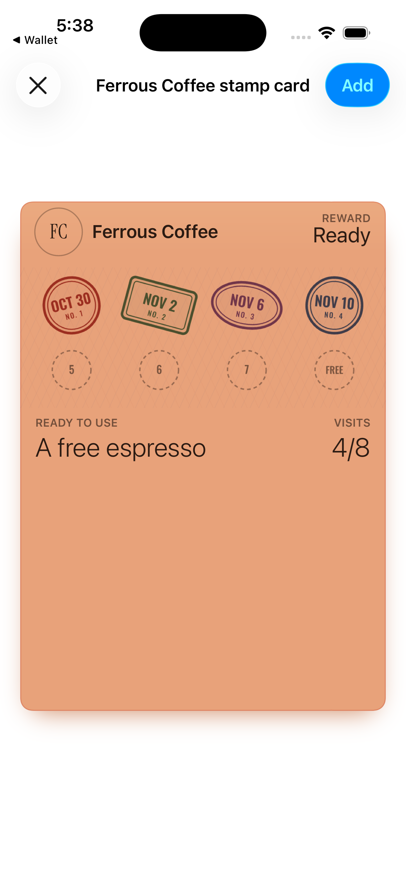
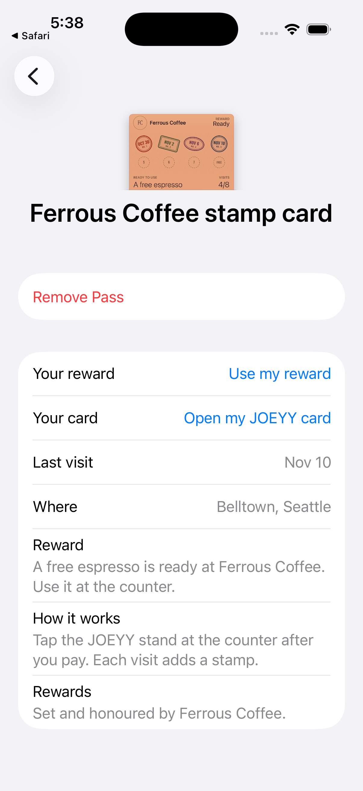
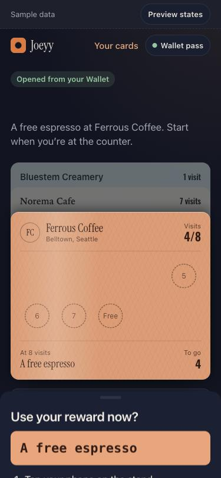
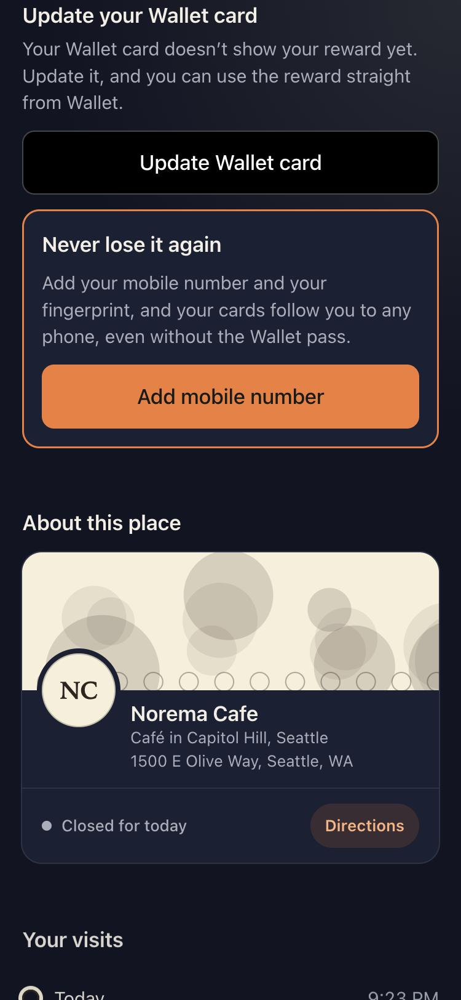

- **The pass leads with the reward** once one is ready: the header reads "Reward: Ready", which is
  all you see while the pass sits in the Wallet stack, and the front says "Ready to use: A free espresso".
- **"Use my reward"** is the first thing on the back. It signs Safari in and opens the "Use your
  reward now?" sheet; the diner taps the stand and shows the staff screen as before.
- **Notifications:** when the pass updates with a new reward, Wallet shows "A free espresso is ready
  at Ferrous Coffee". Ordinary stamps don't notify.
- **Update Wallet card:** the preview can't push pass updates, so the card page notices when the
  pass is behind (for example, the card just filled) and offers to update it. Once a card is in
  Wallet, the Add buttons give way to "In your Wallet".
- **Update Wallet card is always there** once a card is in Wallet: on the card page and under an
  opened card in Your cards. It's the primary button when the pass is behind, and a quieter one
  otherwise, for demos and missed push updates.
- **Stamp-by-stamp demos:** an **Add a stamp** button in the Preview bar taps the stand for the card
  on screen (skipping the one-a-minute limit), and "Wallet demo: start a card at one stamp" resets
  Norema to one stamp while keeping its card ID, so its Wallet pass is replaced rather than duplicated.
- **Fix:** "Last visit" on the pass showed the day before for date-only visits.
- **Fix:** pass links said "This link has expired" when opened in another browser or after a
  Preview reset, because the demo kept their accounts in browser storage. The dev server now keeps
  them (`.wallet/demo-accounts.json`), and the page for a dead link says what to do instead.
- **Preview states → Rewards:** "Card fills while it's in Wallet" and "Use my reward, from the
  Wallet pass".

## v3.7: reorder your cards

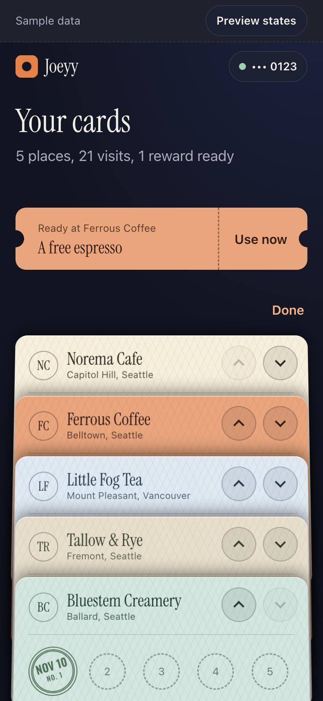

- **Press and hold** a card in Your cards (about 0.4 s). It lifts with a small buzz, follows your
  finger, and the other cards slide aside. A quick swipe still scrolls and a quick tap still opens.
- **Edit order** turns on up and down arrows on every card, for anyone who can't drag or uses a
  keyboard or screen reader. Moves are announced ("Norema Cafe moved to position 1 of 5") and
  focus stays on the arrow.
- **Saved to the account** with `PUT /v1/web/me/cards/order`, so the order comes back after
  signing in on a new phone. If saving fails, a toast says so.
- **Fixes:** the "Open card" link no longer shows in the list, and the stack lays out even when
  the tab starts in the background.

## v3.6: real Apple Wallet pass

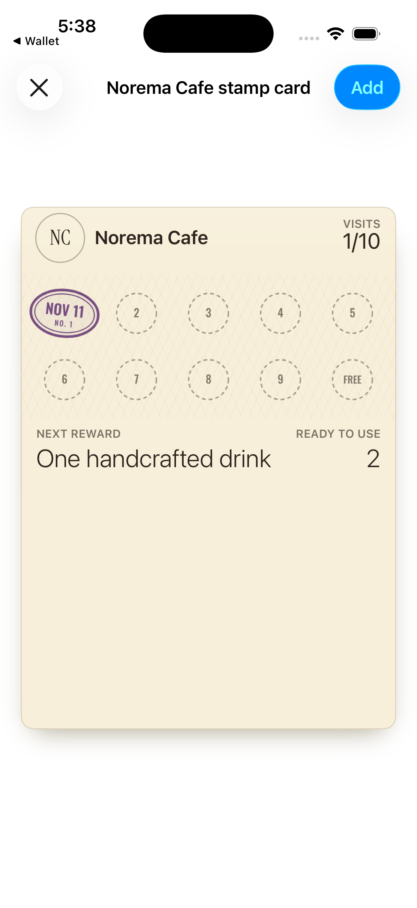
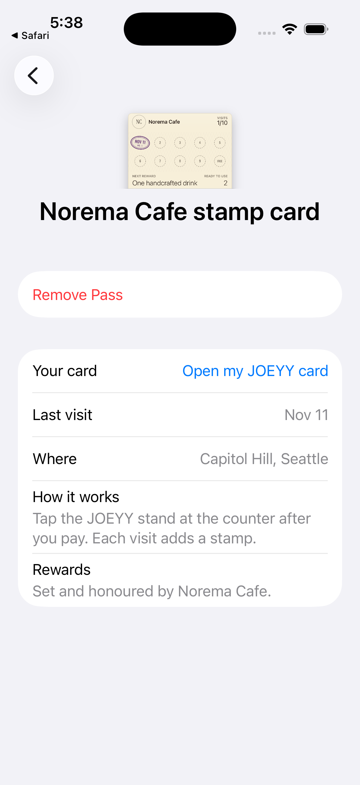
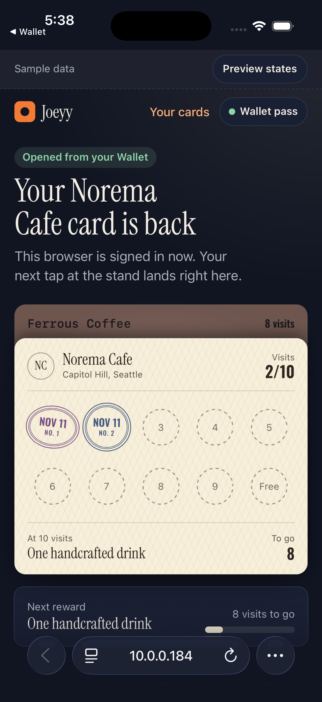
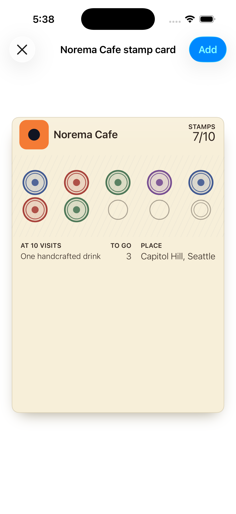

- **Signing:** the dev server signs a real `.pkpass` with the JOEYY Pass Type ID certificate
  (`pass.com.joeyy.stampcard`, team LJP4V355WT). iOS accepts it, including over plain `http://`
  on the local network.
- **The strip:** drawn with the web page's own stamp shapes, angles, ink colours and fonts
  (Oswald and Instrument Serif), rendered from SVG. Each stamp carries its real visit date, then
  come the dashed numbered slots and FREE.
- **Logo and fields:**
  - The restaurant's monogram in a ring is the logo, and the JOEYY tile is the app icon.
  - The front shows Visits, plus only two fields under the strip (Wallet puts four on one row,
    which cramped them): the reward, and how many to go or rewards ready.
- **The back:**
  - **Open my JOEYY card**, which opens `/w/:token` and signs that browser in (tested end to end
    on the simulator).
  - Last visit, where, how it works, and who honours rewards.
- **First try:** plain bullseye stamps, a big orange tile logo, and a cramped field row. The
  second screenshot above is the redesign.

## v3.5: sign-in on a new phone

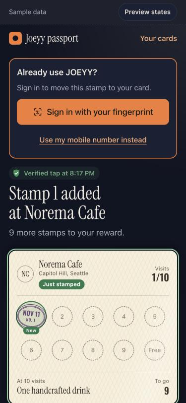
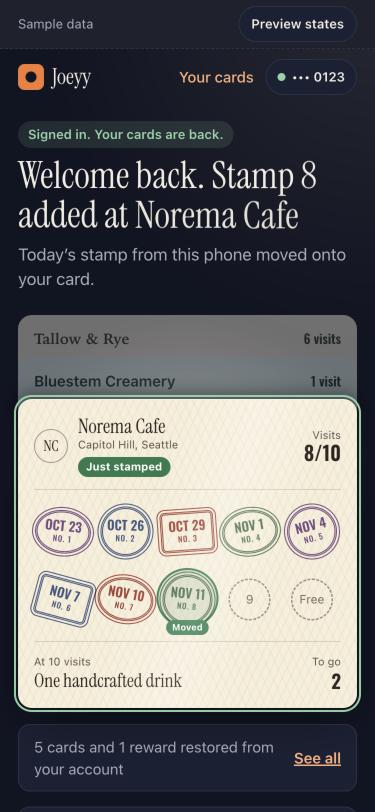
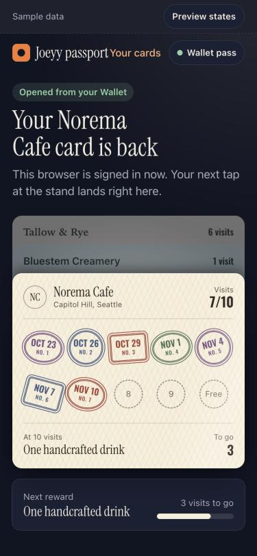
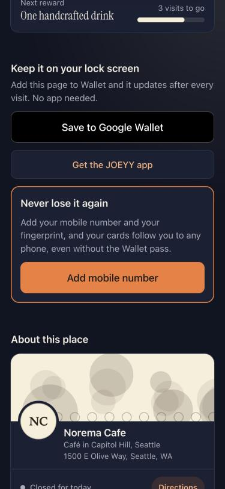

Built from canvas rows A and B, in the theme's own colours only:

- **The stamp still lands,** with an "Already use JOEYY?" banner offering Face ID (fingerprint on
  Android) or "Use my mobile number instead".
- **Signing in merges** this phone's stamp onto the account's card: "Welcome back. Stamp 8 added",
  with the stamp tagged "Moved" and "5 cards and 1 reward restored".
- **After saving a number,** "Use Face ID next time?" adds a passkey.
- **`/w/:token`** is the Wallet pass link: "Your Norema Cafe card is back", with a "Never lose it
  again" box for diners who have no number yet.
- **An account chip** (••• 0123) in the header opens sign-out, for shared phones.
- **Fixes:**
  - The background glow no longer makes the page wider than the phone.
  - The wordmark shortens when the chip needs the room.
- **Preview states → Accounts and sign-in:** new phone with Face ID, new phone without Face ID
  (text code), open my card from the Wallet pass, already signed in.
- **Canvas mockups A2 and B2** were redrawn in the theme's colours. They had drifted to iOS grey,
  blue and green.

## Design canvas: new phone and ways back in

Mockups only, on the [Claude Design canvas](https://claude.ai/artifact/NoWHBxjhcHufoKQ6U2zUno),
in rows 2 and 3:

- **A1:** the stamp lands on the new phone, with an "Already use JOEYY? Sign in with Face ID" banner.
- **A2:** the browser's passkey prompt. The passkey came over with iCloud Keychain.
- **A3:** "Welcome back. Stamp 8 added". The stamp moves onto the real card and the other cards return.
- **A4:** the fallback: mobile number, with the text code filled in from Messages.
- **B1:** on the old phone, after saving a number: "Use Face ID next time?"
- **B2:** the Wallet pass details, with an "Open my JOEYY card" link.
- **B3:** "Your Norema card is back", opened from the Wallet link.

## v3.4: depth and motion

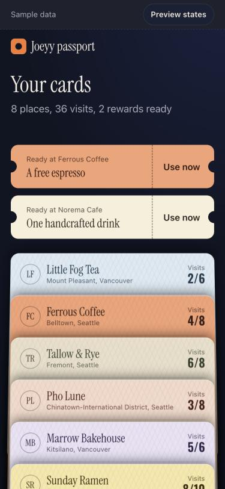
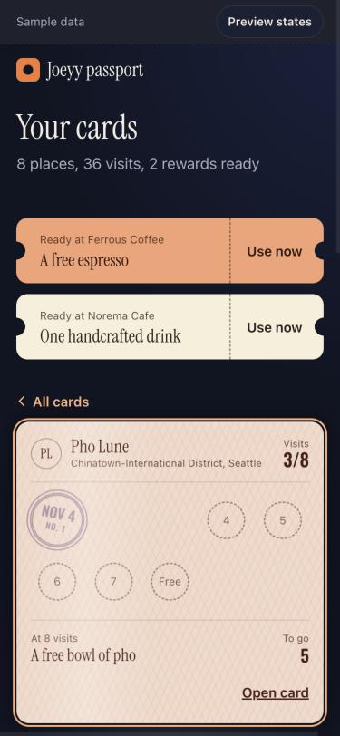
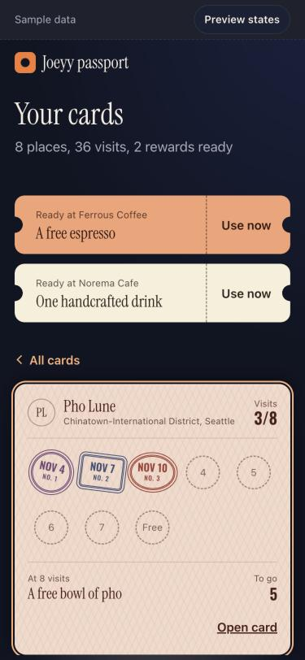

- **Depth:**
  - Cards in the list lean back 7° with perspective, like passes standing in a stack.
  - Pages have a paper-edge highlight and a deeper shadow.
  - A soft glow in the open page's colour sits behind it.
- **Tilt:** the open page (and the page on the card screen) tilts toward your finger, with light following it.
- **Opening a card:** a band of light sweeps across it, and its stamps land again one after another.
- **Arrival:** the headline's words rise in one after another.
- **Scrolling:** sections ease up as they come into view, and progress bars fill when they appear.
- **Reduce Motion:** turns all of the above off.

## v3.3: card details

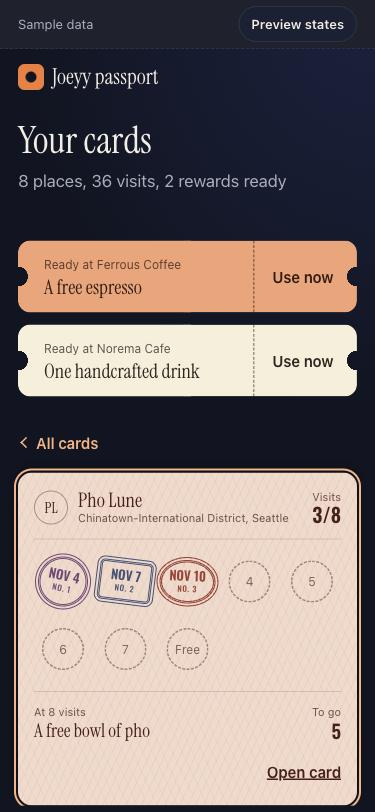
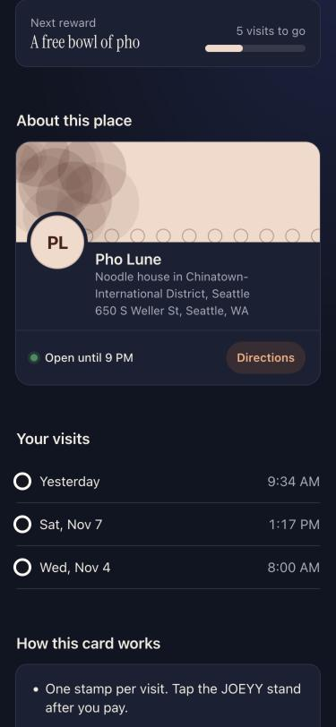

- **Under an opened card:**
  - Next reward with a progress bar
  - "About this place": cover art, logo badge, type of place, address, hours, Directions
  - Recent visits
  - "How this card works"
  - A link to the card's full page
- **On the card and tap page:** the same next-reward bar and About section.

## v3.2: one card at a time, eight places

- **Opening a card:** the other cards drop away out of sight, and "All cards" brings the list back.
- **New sample places:** Pho Lune, Marrow Bakehouse, Sunday Ramen and Bluestem Creamery, plus a
  "Full wallet" preview state with all eight.
- **Motion:**
  - Cards deal in on arrival.
  - The opened card springs up.
  - The others cascade away and back.
  - Cards press in under your finger.

## v3.1: Apple Wallet slide

- Cards overlap in a list. Tap one and it slides to the top while the others pile at the bottom.
- Superseded by v3.2: the pile under the open card was confusing.

## v3: passport in a Wallet stack

- **The page:** each visit is a dated rubber-stamp impression, and the newest gets a "New" halo.
  The page you tapped sits in front of your faded other cards, with a "Just stamped" badge.
- **Theme:** navy cover, each business's pages in its own paper colour, Instrument Serif and Oswald type.
- **Removed:** the paper punch card from v1–v2, and the flip and tilt from v2.

## Design canvas exploration

Mockups only, on the [Claude Design canvas](https://claude.ai/artifact/NoWHBxjhcHufoKQ6U2zUno):

1. Paper card (v2 as it was then)
2. Receipt: a till receipt with red rubber-ink stamps
3. Passport stamps
4. Full bleed: the whole screen in the restaurant's colour, with huge type
5. Wallet stack: dark, Apple Wallet-like
6. Passport stamps in the Wallet stack (picked, which became v3), and 6b, Your cards as a passport stack

## v2: richer card page

- JOEYY logo mark
- Restaurant header with cover art, logo badge, hours and Directions
- "Verified tap" seal
- A card you could drag to tilt and tap to flip for its rules
- Next-reward bar
- A reward ticket that prints out when a card fills
- Wallet pass preview
- Visit history
- "How JOEYY works"
- "More spots" gallery

## v1: paper card

- A web port of the iOS app's `PunchCard`: earned slots cut through the paper, and the new stamp
  presses the card and drops the punched-out disc.
- Every tap outcome: stamped, completed, double tap, old link, unreadable, not set up, retired, offline.
- Anonymous identity with an optional mobile number.
- The redeem countdown, and a staff screen with a live clock and a colour of the day.

---

## How to record a new iteration

1. Make the change, then run `npm run build` to check it.
2. Save phone-size screenshots to `docs/iterations/vX.Y-name.jpg`.
3. Add a row to the table and a section above, newest first.
4. Commit and tag it: `git commit -am "Design vX.Y: …"` and `git tag design-vX.Y`.
