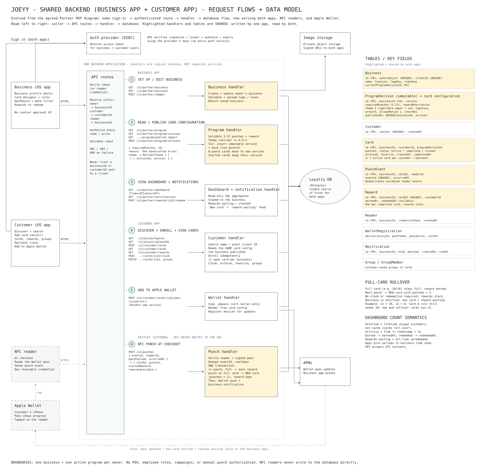

# JOEYY backend specification (MVP)

Status: **partly implemented.** The database is Azure Database for PostgreSQL (`joeyy-dev-pg`,
database `joeyyRewards`), images are in a private Azure Blob Storage container, and the partner
routes in section 8.1 (except redeem) are built in [backend/](../backend/README.md). Both apps still
run on local sample data.
This document defines the **one shared backend** that both the customer app and the business
(partner) app will use once they move off sample data. It follows the agreed Partner MVP
Excalidraw diagram (sign in → authenticated route → handler → database) and extends the same
design to the customer app, NFC readers, and Apple Wallet. Section 2 is the architecture diagram;
the rest of this document specifies each numbered flow in it.

## 1. Scope

In scope for the MVP:

- One backend application: a single deployable API with logical modules, not separate services.
- One relational database (Postgres) and private object storage for images.
- Business owner sign-in, business profile, card program versions, card design, and dashboard.
- Customer sign-in, discovery and search, enrollment, cards, rewards (coupons), favorites, and groups.
- NFC punch intake with validation, full-card rollover, and reward stacking.
- Apple Wallet pass issuance and updates.
- Partner notifications for new cards and rewards waiting to be redeemed.

Out of scope (per the diagram's boundaries): POS integration, employee roles, more than one
business per owner, more than one active program per business, campaigns, a manual punch
authorization UI, and analytics workers or caches.

## 2. Architecture



Diagram sources (open or edit at [excalidraw.com](https://excalidraw.com) via **Open**):

- [`architecture/shared-backend.excalidraw`](architecture/shared-backend.excalidraw): the shared
  backend for both apps (the diagram above).
- [`architecture/partner-mvp.excalidraw`](architecture/partner-mvp.excalidraw): the original
  agreed Partner MVP diagram it evolved from, kept for reference.

What carries over from the Partner MVP diagram unchanged:

- **One backend application.** Handlers are logical modules in one deployable API, not
  separate services. No analytics worker or cache.
- **The same request path** for every caller: an authenticated route, then a handler, then the
  database. Responses return on the same connection.
- **API routes** verify the token, resolve the caller, authorize every read and write, validate
  input, and never trust a client-sent `businessId`.
- **Flows 1–3** (business setup, card rules, dashboard), the image storage flow, and the
  Business, ProgramVersion, Card, PunchEvent, and Reward tables keep their original shape.
- **Boundaries**: one business and one active program per owner; no POS, employee roles,
  campaigns, or manual punch authorization; NFC never writes directly to the database.

What changes to make it shared:

| Diagram change | Why |
| --- | --- |
| The customer app signs in with the same auth provider and calls the same API (flows 4–5) | One backend and one database for both apps; no separate customer service |
| The API also resolves `customer → customerId` and `reader → businessId` | Every caller type is authorized the same way |
| The program version becomes the **card configuration** (`MerchantTheme`, 3–12 punches) | The customer app reads exactly what the business published |
| The external "Customer / NFC integration" becomes flow 6 (punch handler) | Rollover, deduplication, and notifications need one owner |
| Adds Wallet handler and APNs | Pass issuance and live updates after every punch |
| Adds the Customer, Reader, WalletRegistration, Notification, and Group tables | Customer accounts, reader credentials, push registration, and business notifications |
| Flow 3 adds notifications and redemption | The business sees new cards and rewards to redeem |

Flows in the diagram and where they are specified:

| # | Caller | Flow | Handler | Spec |
| --- | --- | --- | --- | --- |
| 1 | Business app | Set up or edit the business | Business handler | 8.1 |
| 2 | Business app | Read or publish the card configuration | Program handler | 3.1, 4, 8.1 |
| 3 | Business app | Dashboard, notifications, redemption | Dashboard and notification handler | 7, 8.1, 8.4 |
| 4 | Customer app | Discover, enroll, view cards and rewards | Customer handler | 4, 8.2 |
| 5 | Customer app | Add to Apple Wallet | Wallet handler | 6 |
| 6 | NFC reader | Punch at checkout | Punch handler | 4, 5 |

Components:
- **Auth provider**: an OIDC provider issues access tokens (Entra External ID was prototyped).
  The API verifies signature, issuer, audience, and expiry using the provider's published keys.
  There is no separate auth service.
- **API routes**: every request is authenticated and the caller is resolved
  (`ownerSubject → businessId` for business owners, `subject → customerId` for customers, and the reader credential `→ businessId` for NFC readers). Every read
  and write is authorized against that identity, and input is validated. Failures return `401`,
  `403`, or `400`. **Never trust a `businessId` or `customerId` sent by a client.**
- **Image storage**: private object storage, the only place an image is kept (section 3.2). The
  backend validates and uploads images and returns keys; apps display images through short-lived
  URLs that the backend returns.
- **Loyalty DB**: Postgres, the single source of truth for both apps.

## 3. Shared resources

These records are shared by both apps. Once the backend exists, neither app keeps its own copy.

| Resource | Written by | Read by | Notes |
| --- | --- | --- | --- |
| Business | Partner app | Customer app (search, card header) | Name, location, logo, client ID |
| Program version (card configuration) | Partner app (publish) | Customer app, punch handler, Wallet | `requiredPunches`, reward, `MerchantTheme`, cover |
| Card | Punch handler, customer enrollment | Both apps, Wallet | Progress toward one reward |
| Punch event | Punch handler | Both apps (history, dashboard) | Deduplicated by `eventId` |
| Reward (coupon) | Punch handler | Both apps | One per full card; rewards stack |
| Images | Partner app | Both apps | Logo, cover photo |
| Partner notification | Punch and redemption handlers | Partner app | New card started, reward waiting |

### 3.1 Card configuration contract

The card configuration is the published **program version**. The customer app's `Place` and
`MerchantTheme`, and the partner app's `ProgramVersion` and `CardDesign`, must map one-to-one
to this contract, so the card designer preview is exactly what customers see.

```json
{
  "versionId": "uuid",
  "version": 2,
  "requiredPunches": 10,
  "rewardDescription": "One handcrafted drink",
  "theme": {
    "lightPaper": "#F7EFD9", "lightInk": "#2F241E",
    "darkPaper": "#2F241E", "darkInk": "#F7EFD9",
    "typeface": "serif",
    "artwork": "cloud",
    "coverKey": "businesses/<businessId>/cover/<uuid>.jpg",
    "coverURL": "https://example.invalid/signed-url",
    "allowsMotion": true
  },
  "publishedAt": "2026-11-09T18:00:00Z"
}
```

Rules (identical to the apps):

- `requiredPunches` is an integer from **3 to 12** (`Place.punchRange`).
- `rewardDescription` is trimmed and 1–60 characters (`ProgramDraft.rewardLimit`).
- `typeface` is `standard`, `rounded`, `serif`, or `monospaced` (`MerchantTheme.Typeface`).
- `artwork` is `rail`, `cloud`, or `stone` (Clipped, Rounded, or Square card stock).
- The light and dark ink/paper pairs must each meet a **4.5:1** contrast ratio
  (`MerchantTheme.validate()`). The server re-validates and rejects failures with `400`.
- `coverKey` is the key of a cover this business uploaded (section 8.1), or `null` for the card's
  original artwork. Apps send `coverKey` when publishing; `coverURL` is set only by the server and
  is short-lived (section 3.2).
- Business name is 1–40 characters and location is at most 120 characters.
- Versions are **immutable**. Publishing inserts a new version and moves the business's live
  pointer in one transaction. Publishing identical settings is rejected (`409 unchangedProgram`).

### 3.2 Where images live

In account mode (section 11), an image has exactly one real home, and anything on a phone is a
disposable copy.

```
  Real image (kept)                          Copy on a phone (thrown away freely)
  ─────────────────                          ────────────────────────────────────
  Azure Blob Storage: the bytes              App's Caches folder, keyed by image key
  Postgres: logoKey, coverKey                Never in the Photos library
  Changed only through the API               Never in the app's saved data
  Deleted only through the API               iOS or the app may delete it at any time
```

Rules for the apps:

1. **The apps store keys, never image bytes.** The saved business and card data in account mode
   hold `logoKey` and `coverKey` only. Image bytes are never written to the app's saved data
   (Application Support, UserDefaults, or the demo JSON file).
2. **A cache is optional.** An app may simply download `logoURL` or `coverURL` each time it shows
   an image. If it keeps copies, they go in the Caches folder (excluded from backups, and cleared by
   iOS when space runs low), filed under the image key, not the URL.
3. **A changed key means a changed image.** Keys are never reused, so a cached copy is always
   correct for its key, and a new key means download again. Nothing else needs to expire.
4. **Losing the cache is harmless.** A missing copy is downloaded again through a fresh URL from
   the API. The app never shows an error because a cached copy is gone.
5. **Signing out clears the cache.** Signing out and deleting the account remove every cached image,
   so the next person on a shared phone never sees the last account's images.
6. **No access to the Photos library is needed** to show images. The photo picker is used only to
   choose an image to upload.

Rules for the backend:

1. **An image is in use** while the business's `logoKey` or any version's `coverKey` points to it.
   Covers on older versions stay in use, because version history shows them.
2. **Unused images are deleted.** An upload attached to nothing is kept for 24 hours, so an app can
   upload and then save; after that it's deleted, as is a replaced logo. Apps should upload just
   before saving, and upload again if a save returns `400 unknownImage`.
3. **Deleting a business deletes its images,** whatever deletes the business.
4. **No file is forgotten.** Each deleted image is queued, and its file is deleted from storage
   afterwards, with failures retried. Storage keeps deleted files recoverable for 7 days.

The 15-minute URL limits who can fetch the file from storage. It does not limit how long an app
may show or cache an image it was allowed to download. Demo mode keeps its images on the device
as it does today (section 11.2).

## 4. Card lifecycle and full-card rollover

This is the agreed behavior. It replaces the earlier "claim before collecting again" rule.

1. **Enroll**: a customer adds a business's card in the app. This creates a card on the live
   version with 0 punches. Enrollment is idempotent: one open card per customer per business.
2. **Punch**: each validated NFC tap adds one punch to the customer's open card.
3. **Full**: when `punches == requiredPunches`, the card becomes `completed` and **one reward is
   earned** (`earnedAt` is the time of the completing punch). The card stays full; nothing resets.
4. **Rollover**: the next validated punch on a completed card **automatically creates a new card**
   on the live version, with that punch as its first (`punches = 1`). No claim or redemption is
   needed. The full card's reward stays available.
5. **Stacking**: rewards accumulate. A customer can hold any number of unredeemed rewards for
   the same business.
6. **Optional claim**: the customer app can close a full card early ("Claim reward"). This
   starts the next card at 0 punches. It does not redeem the reward.
7. **Redeem**: a reward is redeemed once (`redeemedAt` is set). Redeeming never changes punches.

Version rules when a new version is published:

- Cards with punches keep their version's rules and look until they are complete.
- Open cards with 0 punches move to the new live version, since no progress is lost.
- New enrollments and rollover cards always use the live version.
- Version usage is **Live** (current), **Finishing** (older, with cards still in progress), or
  **Retired** (older, with none in progress).

Example: v1 needs 10 punches and v2 needs 8. Card A (v1, 4 punches) still needs 10. A new
card B, or a rollover card, uses v2 and needs 8.

## 5. NFC punch intake

The diagram treats NFC as external: **NFC does not write directly to the database.** Readers
send events to the punch handler, which validates and records them.

Flow: after a purchase, the customer taps their Wallet pass (or the app) on the business's
reader. The reader reads the pass's NFC payload and sends a punch event. The backend validates
the event, applies rollover, records it, updates the Wallet pass, and notifies the business.

`POST /v1/punches` (authenticated as a reader)

```json
{
  "eventId": "nfc-6c1f…",
  "readerId": "reader-uuid",
  "passPayload": "<signed NFC payload from the Wallet pass>",
  "occurredAt": "2026-11-09T18:04:11Z"
}
```

`eventId` is unique per tap and generated by the reader.

Validation requirements:

- Each reader is registered to exactly one business and authenticates with its own revocable
  credential, not a user token. Unknown or revoked readers get `401`.
- The pass payload is signed and verified server-side and must identify the customer's pass for
  **that** business. A pass for another business gets `403`.
- `eventId` is unique. A duplicate returns the original result (`200`, idempotent) and never
  adds a second punch.
- `occurredAt` must be within a small window of server time (for example ±5 minutes).
- Cooldown: at most one punch per pass per business within a configurable window (default
  60 seconds) to absorb double taps.
- A tap from a customer with no open card for that business enrolls them first.

Response:

```json
{
  "cardId": "uuid",
  "punches": 1,
  "requiredPunches": 10,
  "startedNewCard": true,
  "rewardsAvailable": 2
}
```

The punch event, any rollover card, and any reward are written in **one transaction**.

## 6. Apple Wallet

- `POST /v1/customer/cards/{cardId}/pass` returns a signed `.pkpass`. The Pass Type ID
  certificate is held only by the backend, never in the apps. Pass images are rendered from the
  program version's theme, logo, and cover, within Apple's native pass layout.
- Implement Apple's **PassKit web service**: register and unregister devices, list updatable
  passes, return the latest pass, and accept logs.
- After every punch, rollover, or redemption, the backend sends an APNs Wallet update push so
  the pass shows current progress and available rewards.
- The pass carries the NFC payload used in section 5 and a barcode fallback.

## 7. Partner notifications

Customers usually see progress only in Wallet, so the business needs to know when rewards are
waiting.

- Events: `card.rolledOver` (a new card started from a full card) and `reward.waiting` (the
  number of unredeemed rewards changed).
- Delivery: an in-app notification list, plus optional APNs push to the partner app. Pushes are
  batched (for example, at most one per business every 15 minutes) to avoid noise.
- `GET /v1/partner/notifications?after=<cursor>` returns notifications, newest first.
- The dashboard returns `rewardsWaiting` (all-time unredeemed) and `customersWithStackedRewards`
  (customers with more than one unredeemed reward). The partner app's Overview already shows
  both from sample data.

## 8. API

All routes are versioned under `/v1` and use JSON over HTTPS with UTC ISO 8601 timestamps.

### 8.1 Partner (owner token)

| Method | Route | Purpose |
| --- | --- | --- |
| GET | `/v1/partner/business` | The owner's business, or `404` before setup |
| PUT | `/v1/partner/business` | Create or update name, location, and logo key (upsert on `ownerSubject`) |
| POST | `/v1/partner/images?kind=logo\|cover` | Upload a logo or cover (the request body is the image), validate type and size, return its key and a short-lived URL |
| GET | `/v1/partner/program` | The live version |
| GET | `/v1/partner/program/versions` | All versions, with usage (Live, Finishing, Retired) and counts |
| GET | `/v1/partner/program/publish-impact` | `{ keepRules, switchToNew }` |
| POST | `/v1/partner/program/versions` | Publish a new immutable version |
| GET | `/v1/partner/dashboard?from&to` | Counts (see 8.4) |
| GET | `/v1/partner/notifications` | New cards started and rewards waiting |
| POST | `/v1/partner/rewards/{rewardId}/redeem` | Mark a presented reward redeemed (see open decision 1) |

### 8.2 Customer (customer token, except places)

Places are public, like a menu in the window: anyone can search them and read a place's card
without signing in, so the website and app can show them before sign-in. They return nothing about
customers.

| Method | Route | Purpose |
| --- | --- | --- |
| GET | `/v1/places?query=` | Search by business name or exact client ID (not location). **No token needed** |
| GET | `/v1/places/{placeId}` | A business and its live card configuration. **No token needed** |
| POST | `/v1/customer/cards` | Enroll in a business (idempotent) |
| GET | `/v1/customer/cards` | Open cards with progress, archived state, and favorites |
| POST | `/v1/customer/cards/{cardId}/claim` | Optionally close a full card early |
| PATCH | `/v1/customer/cards/{cardId}` | Archive or restore; favorite or unfavorite |
| GET | `/v1/customer/rewards` | Available and used rewards (the Redeemed tab) |
| GET, PUT, DELETE | `/v1/customer/groups[/{id}]` | Groups (unique names, 1–40 characters) |
| POST | `/v1/customer/cards/{cardId}/pass` | A signed Wallet pass |

### 8.3 Devices

| Method | Route | Purpose |
| --- | --- | --- |
| POST | `/v1/punches` | NFC punch intake (section 5) |
| POST | `/v1/dev/punches` | Development only: a punch without a reader (section 11.3) |
| Various | `/v1/wallet/…` | Apple PassKit web service (section 6) |

### 8.4 Dashboard semantics

- `enrolledCardholders` is lifetime **unique customers** (`COUNT DISTINCT customerId`), not cards,
  because cards roll over.
- Activity counts use the half-open range `from <= timestamp < to`.
- `punches` uses `PunchEvent.occurredAt`, `rewardsEarned` uses `Reward.earnedAt`, and
  `rewardsRedeemed` uses `Reward.redeemedAt`.
- `rewardsWaiting` and `customersWithStackedRewards` are all-time.
- Apps choose periods in the business's time zone and send UTC instants.
- Counts are read-only SQL aggregates scoped to the business, indexed by `businessId` and timestamp.

## 9. Data model

| Table | Key fields |
| --- | --- |
| Business | `id` PK, `ownerSubject` UNIQUE, `clientId` UNIQUE, `name`, `location`, `logoKey`, `timeZone`, `currentProgramVersionId` FK |
| ProgramVersion | `id` PK, `businessId` FK, `version`, `requiredPunches`, `rewardDescription`, `theme` (JSON per 3.1), `coverKey`, `publishedAt`; UNIQUE(`businessId`, `version`) |
| Customer | `id` PK, `subject` UNIQUE, `createdAt` |
| Card | `id` PK, `businessId` FK, `customerId` FK, `programVersionId` FK, `punches`, `status` (`active`, `completed`, `closed`), `archived`, `favorite`, `createdAt`, `completedAt`; at most one `active` card per (`customerId`, `businessId`) |
| PunchEvent | `id` PK, `businessId` FK, `cardId` FK, `readerId` FK, `eventId` UNIQUE, `occurredAt`, `receivedAt` |
| Reward | `id` PK, `businessId` FK, `cardId` FK UNIQUE, `customerId` FK, `earnedAt`, `redeemedAt` (nullable) |
| Reader | `id` PK, `businessId` FK, credential hash, `revokedAt` |
| WalletRegistration | Device library ID, push token, pass serial, `cardId` |
| Notification | `id` PK, `businessId` FK, `kind`, `payload`, `createdAt`, `readAt` |
| Image | `id` PK, `businessId` FK, `kind` (logo or cover), `storageKey` UNIQUE, `contentType`, `byteSize`, `width`, `height`, `createdAt` |
| Group, GroupMember | Customer groups and their cards |

As built (`backend/db/migrations`): owners are a `business_owners` table keyed by `subject`, and the
business `id` doubles as the client ID. `PunchEvent.eventId` is unique per business, so one
business's reader can't affect another's deduplication. A business's `logoKey` and a version's
`coverKey` are foreign keys to an Image of the same business.

Constraints: one reward per completed card; `punches` between 0 and the card's version's
`requiredPunches`; `redeemedAt` after `earnedAt`; and every business-owned row carries
`businessId` for scoping.

## 10. Security and non-functional requirements

- Tokens are verified on every request, and authorization is scoped to the resolved business or customer.
- Readers use separate, revocable credentials; NFC payloads are signed; punch events are idempotent.
- The Wallet signing certificate and APNs keys live in a secrets store, never in the apps or the repository.
- Images: PNG or JPEG only (the apps convert HEIC photos on the device before uploading), at most
  5 MB, re-encoded with metadata stripped, and kept in private storage.
- Location search stays on the device through Apple Maps; the backend stores only the chosen text.
- No personal data beyond the auth subject; customers are pseudonymous to businesses.
- Structured logs with request IDs; no tokens or pass payloads in logs.
- MVP targets: p95 punch intake under 500 ms; Wallet update push sent within 10 seconds of a punch.
- Development environment only until a production review; no production data in development.
- Infrastructure as code; deploys from CI through OIDC, with no stored cloud secrets.

## 11. Demo mode and account mode

Both apps keep a demo that runs entirely on the device, next to the real backend. The two are
**separate modes**, not a mix: demo data never reaches the backend, and backend data never lands
in the demo store.

```
                 Welcome screen
          ┌────────────┴────────────┐
   "Explore a demo"             "Sign in"
          │                         │
     Demo mode                 Account mode
   (on the device)             (the backend)
          │                         │
   Local data source          Remote data source
   • today's JSON and         • API client and token
     UserDefaults storage     • images uploaded, then attached by key
   • sample business and      • stamps only from real punches
     sample places              (section 5)
   • "Add demo stamp"
          │                         │
   stays on the phone       API ─▶ Postgres and Blob Storage
```

### 11.1 How the apps are built

- Screens call one interface per side and never know which mode is active. The partner side has a
  `PartnerDataSource` and the customer side has a matching one for `LoyaltyStore`.
- Each interface has two implementations. The **local** one is today's on-device storage (the
  `PartnerStore` JSON file and the `LoyaltyStore` UserDefaults data). The **remote** one is the
  shared API client.
- Calls are `async` in both, so screens handle loading and errors the same way whichever mode answers.
- The mode is chosen on the Welcome screen: **Explore a demo** or **Sign in**. It's remembered
  across launches and can be switched from settings.

### 11.2 Rules

1. **Demo data stays on the device.** A demo action never calls the API, uploads an image, or
   needs a token. Backend responses are never saved into the demo store.
2. **Each mode keeps its own data.** Switching modes doesn't delete, merge, or copy anything,
   just as switching between the customer and business sides works today.
3. **Demo mode is always labeled**, for example with a "Demo" badge, so a sample business is
   never mistaken for a real one.
4. **Demo shortcuts exist only in demo mode.** These are "Add demo stamp", loading the Norema Cafe
   sample, and the built-in places. Account mode has no way to add a stamp except a real punch.
5. **Demo businesses are fictional.** `Place.catalog` currently lists real businesses with their
   real addresses and websites; replace them with invented ones before account mode ships.
6. **Both modes follow the same card rules** (sections 3.1 and 4), so a card behaves the same way
   in the demo as it does for a real customer. See open decision 6.
7. **UI tests use demo mode.** They need no server, network, or token.

### 11.3 Testing account mode before readers exist

Until NFC readers exist (open decision 4), account mode can't add a stamp. A **dev-only route**
runs the real punch logic so the whole flow can be tested against Azure:

`POST /v1/dev/punches` (partner token) with `{ "customerId" }`

- Runs the same handler as section 5: enrollment if needed, rollover, rewards, and notifications,
  in one transaction. Only the reader and pass checks are skipped.
- The business comes from the token, as on every partner route.
- The route doesn't exist when `NODE_ENV=production`, like `AUTH_MODE=dev` and `IMAGE_STORE=local`.
- Punches it records are marked as dev punches, so they can be found and removed later.

## 12. Open decisions

1. **Redemption**: how a reward is presented and verified at checkout (for example, an NFC tap
   of a reward pass, or the business confirming it in the partner app). The diagram leaves this
   out of the partner screens; `POST /v1/partner/rewards/{id}/redeem` is a placeholder.
2. **When the customer app shows a coupon**: the backend earns the reward when the card fills,
   while the customer prototype adds the coupon to Redeemed on claim or rollover. Decide whether
   to show it as soon as the card is full.
3. **Reward expiry**: none in the MVP; confirm.
4. **Reader hardware** and how readers are provisioned to a business.
5. **Hosting**: The database is decided: Azure Database for PostgreSQL Flexible Server (Burstable
   B1ms, dev only), with Microsoft Entra sign-in and no stored password. Image storage is decided
   too: a private Azure Blob Storage container with the same Entra sign-in and no account key. Where
   the API runs (for example, App Service or Container Apps with a managed identity) is still open.
6. **Full cards in the customer app**: the customer app (v3) blocks stamps on a full card until the
   reward is claimed and queues extra stamps, while section 4 starts a new card automatically.
   Choose one rule for both modes and both apps (section 11.2, rule 6).

## 13. Exit criteria

The backend MVP is done when every item below is met in a development environment.

Auth and tenancy

- [ ] Partner and customer apps sign in; the API rejects missing, expired, or foreign tokens (`401`).
- [ ] Cross-business and cross-customer access is rejected (`403`), with automated tests.

Business and card configuration

- [ ] A business can be created and edited; its logo and cover upload and display through signed URLs.
- [ ] Publishing validates the 3.1 rules server-side, creates an immutable version, and moves
      the live pointer in one transaction; identical settings return `409`.
- [ ] Publish impact and version usage (Live, Finishing, Retired) match the partner app's local rules.
- [ ] The customer app renders a published card identically to the partner app's preview.

Cards, punches, and rollover

- [ ] Enrollment is idempotent.
- [ ] A punch on a full card creates a new card with 1 punch and keeps the earlier reward
      available, in one transaction, with tests.
- [ ] Rewards stack, there is one reward per completed card, and redeeming never changes punches.
- [ ] Duplicate `eventId`s, revoked readers, wrong-business passes, stale timestamps, and taps
      inside the cooldown add no punches, with tests.

Wallet and notifications

- [ ] A signed pass installs on a device and updates within 10 seconds of a punch or rollover.
- [ ] The partner app shows "new card started" and "rewards to redeem" from the backend.

Dashboard

- [ ] Dashboard counts match section 8.4 against a seeded dataset, including half-open ranges
      and unique-customer enrollment.

Quality

- [ ] API contract tests and the iOS CI (`.github/workflows/ios.yml`) pass on `main`.
- [ ] Both apps offer demo mode and account mode (section 11). Account mode reads and writes only
      through the API; demo mode makes no network calls; UI tests run in demo mode.
- [ ] `POST /v1/dev/punches` is absent when `NODE_ENV=production`, with a test.
- [ ] Load test: 50 punches per second sustained with p95 under 500 ms.
- [ ] Security review is complete, secrets are only in the secrets store, and a monthly cost
      estimate is approved.
